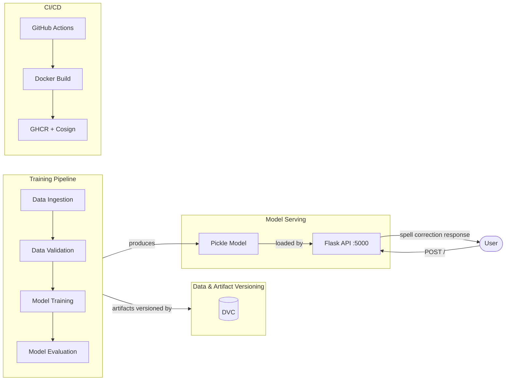
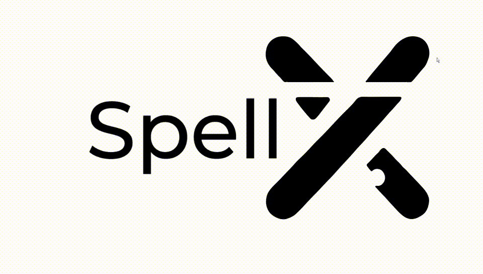

<div align="center">
  
</div>

# SpellX — Production MLOps Platform for Spell Correction

An end-to-end ML system for spelling correction that covers the full lifecycle: data versioning with DVC, reproducible model training, containerized serving with Flask and Docker, and CI/CD with GitHub Actions publishing signed images to GHCR.

## What this project demonstrates

SpellX is a structured implementation of MLOps principles applied to a real NLP task. It covers:

- **Reproducible ML pipelines** — four DVC-managed stages (data ingestion, validation, training, evaluation) with versioned data and artifacts.
- **Containerized model serving** — a Flask API that loads a trained model and exposes spell-correction over HTTP.
- **Automated CI/CD** — GitHub Actions workflows that build Docker images, push signed images to GitHub Container Registry, and validate DVC pipelines on code changes.
- **Config-driven architecture** — YAML-based configuration (`config.yaml`, `params.yaml`, `dvc.yaml`) separating pipeline logic from parameters.

## System architecture



## Production stack

| Component | Technology | Purpose |
|-----------|-----------|---------|
| Data versioning | DVC | Pipeline definition, data/artifact tracking |
| NLP / ML | Spello, NLTK, TensorFlow/Keras | Spell-correction model training and inference |
| API framework | Flask | HTTP serving with HTML UI and feedback collection |
| Containerization | Docker | Reproducible runtime environment |
| CI/CD | GitHub Actions (3 workflows) | Automated build, publish, and DVC validation |
| Container registry | GitHub Container Registry (GHCR) | Image hosting with Buildx multi-platform support |
| Image signing | Cosign / Sigstore | Supply-chain integrity verification |
| Configuration | YAML (config.yaml, params.yaml) | Centralized pipeline and model parameters |

## Repository layout

```
SpellX/
├── src/spellX/               # Core Python package
│   ├── components/            # Data ingestion, validation, training, evaluation
│   ├── pipeline/              # Stage orchestration scripts
│   ├── config/                # Configuration manager
│   ├── entity/                # Config dataclasses
│   └── utils/                 # CharacterTable, trainer, evaluation helpers
├── api/
│   ├── app.py                 # Flask application (routes: /, /submit-feedback)
│   ├── templates/             # HTML templates
│   ├── static/                # CSS, JS, images
│   └── utils/                 # Data handler for corrections and feedback
├── config/
│   └── config.yaml            # Pipeline configuration (paths, URLs, parameters)
├── .github/workflows/
│   ├── docker-image.yml       # Docker build CI on push/PR
│   ├── docker-publish.yml     # GHCR publish with cosign signing
│   └── manual.yml             # DVC pull + pipeline validation
├── dockerfile                 # Python 3.6-slim, Flask serving on port 5000
├── dvc.yaml                   # 4-stage DVC pipeline definition
├── params.yaml                # Model hyperparameters
├── requirements.txt           # Python dependencies
├── setup.py                   # Package installation
└── main.py                    # Pipeline entry point
```

## Local development

```bash
# Clone the repository
git clone https://github.com/IbLahlou/SpellX
cd SpellX

# Install the package and dependencies
pip install -e .
pip install -r requirements.txt

# Run the full training pipeline (data ingestion → validation → training → evaluation)
python main.py

# Or run individual DVC stages
dvc repro data_ingestion
dvc repro model_trainig

# Start the Flask API
cd api
flask run
# API available at http://localhost:5000
```

### Docker

```bash
# Build the image
docker build -t spellx:latest -f dockerfile .

# Run the container
docker run -p 5000:5000 spellx:latest
```

## CI/CD pipeline

Three GitHub Actions workflows automate different aspects of the project:

### `docker-image.yml` — Build validation
- **Trigger:** Push or PR to `main`
- **Action:** Builds the Docker image to verify the Dockerfile is valid and dependencies resolve correctly.

### `docker-publish.yml` — Image publishing
- **Trigger:** Push to `main`, semver tags (`v*.*.*`), daily schedule
- **Action:**
  1. Checkout and set up Docker Buildx
  2. Authenticate with GHCR
  3. Build and push the Docker image with metadata tags
  4. Sign the published image digest with Cosign/Sigstore (supply-chain verification)
- **Registry:** `ghcr.io/iblahlou/spellx`

### `manual.yml` — DVC pipeline validation
- **Trigger:** Changes to any `dvc*.*` file
- **Action:** Installs DVC, pulls versioned data, converts and executes the research notebook to validate the pipeline.

## DVC pipeline stages

The ML pipeline is defined in `dvc.yaml` with four reproducible stages:

| Stage | Script | Inputs | Outputs |
|-------|--------|--------|---------|
| `data_ingestion` | `stage_01_data_ingestion.py` | config.yaml | `artifacts/data_ingestion/data/` |
| `data_validation` | `stage_02_data_validation.py` | config.yaml | `artifacts/data_validation/status.txt` |
| `model_trainig` | `stage_03_model_training.py` | config.yaml | `artifacts/model_trainer/model0.pkl` |
| `model_evaluation` | `stage_04_model_evaluation.py` | config.yaml | `artifacts/model_evaluation/metrics.txt` |

Data is sourced from a [Kaggle spelling dataset](https://www.kaggle.com/datasets/bittlingmayer/spelling) and downloaded automatically during ingestion.

## Engineering decisions and trade-offs

**Flask for serving** — Chosen for rapid prototyping of a web UI with template rendering. Suitable for demonstrating the serving layer; a production deployment would benefit from an async framework (FastAPI) or a dedicated model server.

**DVC for versioning** — Provides Git-like version control for large data files and model artifacts without committing binaries to the repository. Pipeline stages are declared in `dvc.yaml` with explicit dependency tracking.

**Pickle model serialization** — Simple and fast for loading pre-trained Spello models. Trade-off: pickle files are Python-version-sensitive and not portable across environments without careful version pinning.

**Cosign image signing** — Adds supply-chain verification to published container images at zero operational cost via GitHub's OIDC identity tokens.

**Known limitations:**
- No automated tests (pytest is listed as a dependency but no test files exist yet)
- No health, readiness, or metrics endpoints on the Flask API
- Single-stage Dockerfile (no multi-stage build for smaller images)
- Python 3.6 base image (end-of-life; should be upgraded)
- No structured logging or request telemetry
- Committed `.pyc` files and IDE configuration (`.idea/`) that should be in `.gitignore`

## Roadmap

- [ ] Upgrade Python base image to 3.10+
- [ ] Add unit and integration tests for pipeline stages and API
- [ ] Multi-stage Dockerfile for smaller production images
- [ ] Add `/health`, `/ready`, and `/metrics` endpoints
- [ ] `docker-compose.yml` with monitoring stack (Prometheus, Grafana)
- [ ] AWS ECR/EC2 deployment pipeline with Terraform
- [ ] CloudWatch log forwarding and Grafana dashboards
- [ ] Model registry with promotion workflow (staging → production)
- [ ] Kubernetes deployment manifests
- [ ] Canary or blue-green deployment strategy
- [ ] Automated drift-triggered retraining
- [ ] Feature store integration

## Demo


